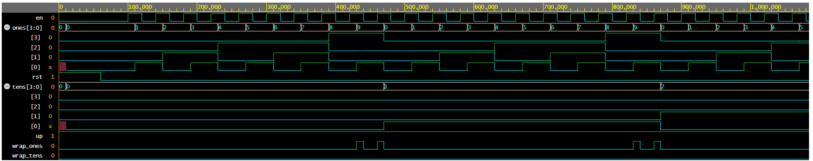

# stopwatch_fpga

Up/down stopwatch (00–59 s) with lap, written in SystemVerilog for the Altera MAX II EPM570 CPLD. Two 7-segment displays, three buttons, 50 MHz clock.

https://github.com/user-attachments/assets/83f6090d-a01c-4bc3-8837-7cb76ee2c2a7

## Features

- Counts seconds 00..59, up or down, with wrap-around (59 → 00 and 00 → 59)
- **Start/Stop** button
- **Up/Down** button switches counting direction
- **Lap/Reset** button: while running it freezes the display (the counter keeps running in the background); when stopped it resets to 00
- Buttons are synchronized, debounced (10 ms) and edge-detected
- Automatic power-on reset, no reset button needed

## Modules

| Module | Purpose |
|---|---|
| `synch` | 2-FF synchronizer for asynchronous button inputs |
| `debounce` | 10 ms debounce counter at 50 MHz |
| `edge_detector` | one-clock pulse on button press |
| `clk_div` | 50 MHz → 1 Hz tick |
| `bcd_digit` | parameterized up/down digit (`MAX` = 9 or 5) with carry/borrow output |
| `stopwatch_ctrl` | control logic: running, direction, lap hold |
| `seg7_decoder` | 4-bit digit → 7-segment pattern |
| `stopwatch` | top level |

## Design note: BCD digits vs. division

Splitting a binary counter into digits with `/ 10` and `% 10` used about **93 logic elements** in my Quartus II compile. Chaining two `bcd_digit` modules (ones 0..9, tens 0..5, tens step on the ones carry/borrow) gives the same behavior in about **14 logic elements**. Counting directly in BCD avoids the divider logic entirely.

## Hardware

- Board: Altera MAX II EPM570T100
- Clock: 50 MHz oscillator on PIN_64
- Displays: two common-anode 7-segment displays, current-limiting resistor on every segment
- Buttons: active low (pressed = 0), each wired between its pin and GND; inverted in the top level
- Note: `seg_ones[5]` and `seg_ones[6]` share pins with the on-board LEDs (PIN_50, PIN_51)

### Pin assignments

| Signal | Pin |
|---|---|
| `clk` | PIN_64 |
| `btn_start` | PIN_6 |
| `btn_dir` | PIN_4 |
| `btn_lap` | PIN_5 |
| `seg_tens[6:0]` | PIN_58, 57, 56, 55, 54, 53, 52 (bit 6 → bit 0) |
| `seg_ones[6:0]` | PIN_51, 50, 49, 48, 47, 44, 43 (bit 6 → bit 0) |

## Build

1. Open `stopwatch.qpf` in Quartus II 13.0 Web Edition
2. Top-level entity: `stopwatch`
3. Compile, then program the `.sof` through the USB-Blaster

## Verification

Self-checking testbenches (Icarus Verilog 12, EDA Playground), both print `ALL TESTS PASSED`:

- `testbench/tb_stopwatch_ctrl.sv` – control FSM: Start/Stop, direction, Lap/Reset, reset behavior
- `testbench/tb_bcd_digit.sv` – two chained BCD digits (0..59) compared with a reference model, up and down, wrap flags

The ones digit wraps 9 → 0 and `wrap_ones` increments the tens digit.
